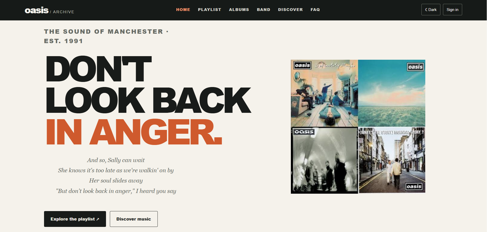
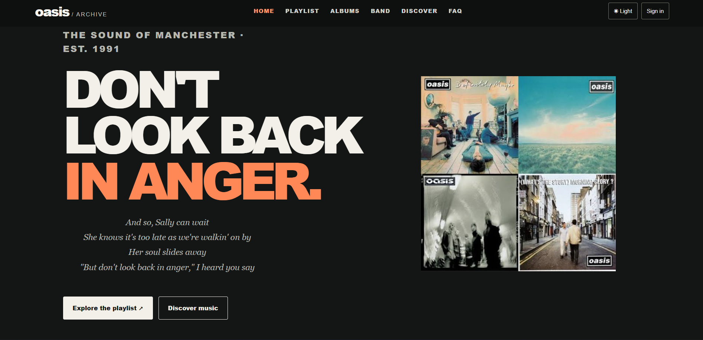
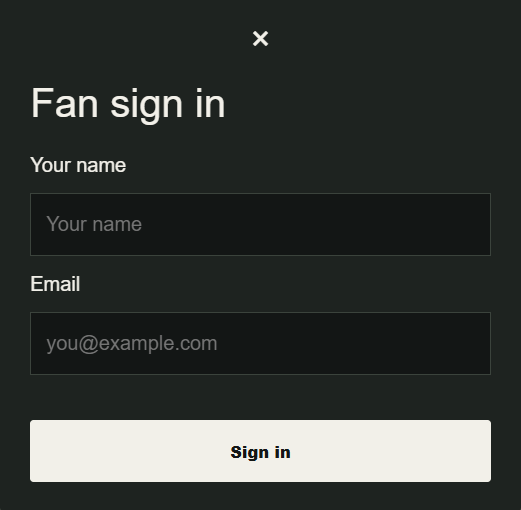
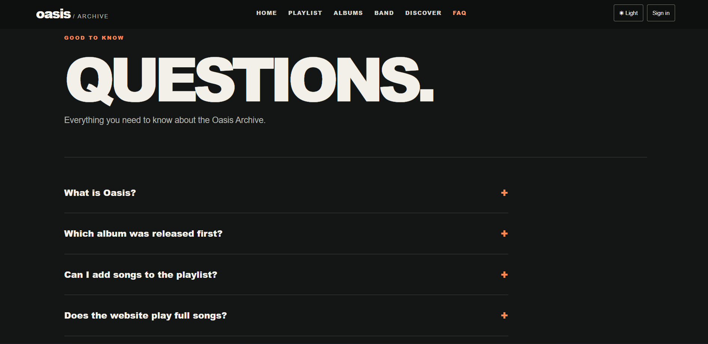
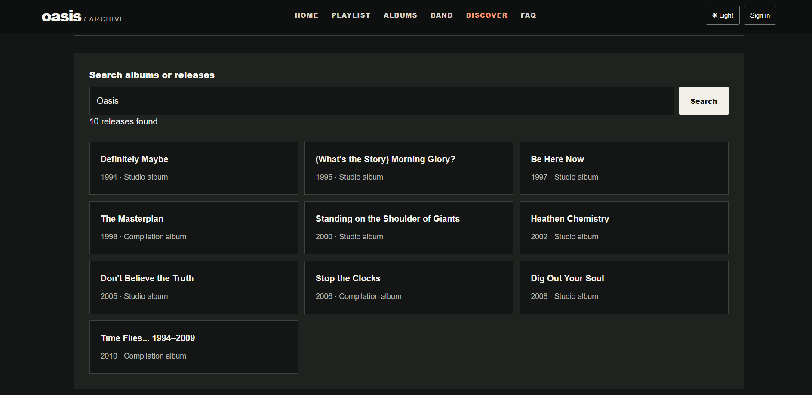

# FinalWeb Project

## About The Project
FinalWeb is a collaborative final web project developed by a group of three undergraduate students at Astana IT University (Group IT-2501). The website is designed to provide a rich, multi-page, interactive experience built strictly according to university course requirements. It includes clean HTML5 semantics, external CSS styling using Flexbox and Grid, dynamic JavaScript functionality (such as theme switching and localStorage authentication), interactive jQuery FAQ components, an integrated public API with error handling, and a dedicated reporting and deployment setup via GitHub Pages.

---

## Project Structure & Features

- **Multi-Page Architecture:** Consists of at least 5 separate, interconnected pages with a consistent visual style, responsive layout for desktop, tablet, and mobile devices, and a persistent navigation bar.
- **Light / Dark Theme Toggle:** Allows users to switch themes dynamically with the selection saved in localStorage to persist across page refreshes.
- **User Authentication:** Fully functional sign-in system utilizing localStorage for input validation, persistent session states, interface adjustments for signed-in users, and a sign-out mechanism.
- **Interactive FAQ Section:** Built using jQuery with smooth .slideToggle() animations and visual indicators (+ / -) for expanded and collapsed states.
- **Public API Integration:** Fetches and processes real-time JSON data using JavaScript (fetch()), complete with user interaction filters/search and error handling for failed requests.

---

## Team Members & Responsibilities

| Name / Role | GitHub Profile | Responsibilities |
| :--- | :--- | :--- |
| **Yermek Dinmukhambet**  *Lead Developer / Fullstack* | [@Dima-IT](https://github.com/Dima-IT) | Core architecture, navigation setup, JavaScript logic implementation (Theme toggle & LocalStorage authentication), and integration. |
| **Baglan Nurgali**  *Frontend & UI Developer* | [@baglan-nurgali](https://github.com/baglan-nurgali) | HTML5 structure, external CSS styling, responsive layout configuration using Flexbox/Grid, and visual consistency across pages. |
| **Sakenov Aldiyar**  *API & jQuery Specialist* | [@Shankslegenda](https://github.com/Shankslegenda) | Public API integration, error handling, dynamic data rendering, jQuery FAQ implementation, and project documentation/report preparation. |

---

## Screenshots

Below are previews of the user interface and key features of the website:

* **Home & Navigation Bar**
  

* **Light & Dark Theme Toggle**
  

* **User Authentication & Sign-in Form**
  

* **Interactive FAQ Section**
  

* **API Data Integration & Search**
  

---

## Getting Started

To get a local copy up and running, follow these simple steps.

### Prerequisites
Make sure you have a modern web browser and a local development server (such as Live Server in VS Code) installed.

### Installation & Setup

1.Clone the repository:
  ```bash
   git clone https://github.com/Shankslegenda/finalWeb.git
  ```
2.Navigate to the project directory:
   ```Bash
   cd finalWeb
   ```
3.Run the application:
Open index.html using a local development server (like VS Code Live Server) to ensure all API requests, theme toggles, and scripts function properly.


Deployed WebsiteLive 

Website: https://shankslegenda.github.io/finalWeb/ 
Github: https://github.com/Shankslegenda/finalWeb

### AI Usage Acknowledgement
Artificial intelligence tools were used as supporting assistants during project development for brainstorming, debugging guidance, and code structure optimization, in accordance with the course AI Usage Policy.   

License Distributed under the academic guidelines of Astana IT University.
